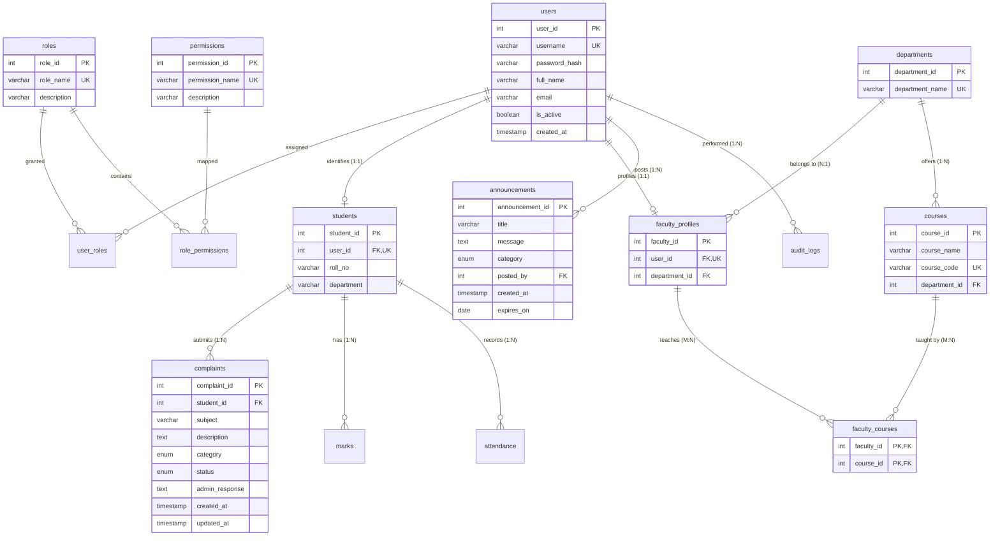

# Object-Oriented Programming (OOP) & DBMS Architecture Documentation

**Project**: Role-Based Access Control (RBAC) & Student Academic Management System  
**Framework**: Spring Boot 3 + Spring JDBC (`JdbcTemplate`) + Thymeleaf + MySQL (InnoDB)  
**Theme**: Full Red & Black Dark Theme (`#0d0d0d`, `#1a1a1a`, `#d90429`)

---

## 1. OOP Concepts Implementation Audit

The codebase strictly adheres to object-oriented programming principles across all layers. Below is the comprehensive audit showing the exact file, class, line numbers, and implementation details for each requirement.

### 1.1 Encapsulation
*Definition*: Encapsulation hides internal state and requires all interaction to occur through well-defined accessors and mutators (private fields, public getters and setters), ensuring data integrity and validation boundaries.

| Entity / DTO / Service | File Path | Class Name | Lines | Encapsulation Details |
| :--- | :--- | :--- | :--- | :--- |
| **BaseEntity** | `src/main/java/com/rbac/model/BaseEntity.java` | `BaseEntity` | L12–L40 | Private fields `id`, `createdAt`; public getters/setters `getId()`, `setId()`, `getCreatedAt()`, `setCreatedAt()`. |
| **BaseUser** | `src/main/java/com/rbac/model/BaseUser.java` | `BaseUser` | L12–L50 | Private fields `username`, `fullName`, `email`; public accessors for user profile management. |
| **User** | `src/main/java/com/rbac/model/User.java` | `User` | L13–L94 | Private fields `username`, `passwordHash`, `fullName`, `email`, `isActive`, `roleIds`; public getters/setters protect sensitive data. |
| **Department** | `src/main/java/com/rbac/model/Department.java` | `Department` | L10–L35 | Private field `departmentName` with public getter and setter. |
| **Course** | `src/main/java/com/rbac/model/Course.java` | `Course` | L10–L55 | Private fields `courseName`, `courseCode`, `departmentId`, `departmentName` with accessors. |
| **FacultyProfile** | `src/main/java/com/rbac/model/FacultyProfile.java` | `FacultyProfile` | L14–L88 | Private fields `userId`, `departmentId`, `departmentName`, `facultyName`, `username`, `email`, `isActive`, `courses` with safe accessors and fallback logic (`getDepartmentName()` returns `"Not assigned"` if null). |
| **Complaint** | `src/main/java/com/rbac/model/Complaint.java` | `Complaint` | L19–L102 | Private fields `studentId`, `studentName`, `rollNo`, `subject`, `description`, `category`, `status`, `adminResponse`, `updatedAt` with helper getters (`isOpen()`, `isResolved()`). |
| **Announcement** | `src/main/java/com/rbac/model/Announcement.java` | `Announcement` | L16–L65 | Private fields `title`, `message`, `category`, `postedBy`, `postedByName`, `expiresOn` with expiration validation (`isExpired()`). |
| **Student** | `src/main/java/com/rbac/model/Student.java` | `Student` | L11–L65 | Private fields `userId`, `rollNo`, `department`, `studentName`; controlled accessors. |
| **StudentUser** | `src/main/java/com/rbac/model/StudentUser.java` | `StudentUser` | L11–L45 | Private fields `rollNo`, `department` with encapsulated accessors. |
| **Mark** | `src/main/java/com/rbac/model/Mark.java` | `Mark` | L11–L54 | Private fields `studentId`, `subject`, `marks` with public accessors. |
| **Attendance** | `src/main/java/com/rbac/model/Attendance.java` | `Attendance` | L11–L66 | Private fields `studentId`, `subject`, `totalClasses`, `attendedClasses`; calculation methods encapsulated. |
| **Role** | `src/main/java/com/rbac/model/Role.java` | `Role` | L10–L44 | Private fields `roleName`, `description` with getters and setters. |
| **Permission** | `src/main/java/com/rbac/model/Permission.java` | `Permission` | L10–L44 | Private fields `permissionName`, `description` with getters and setters. |
| **AuditLog** | `src/main/java/com/rbac/model/AuditLog.java` | `AuditLog` | L13–L76 | Private fields `userId`, `action`, `details`, `status`; enum `Status` encapsulated. |
| **SessionUser** | `src/main/java/com/rbac/model/SessionUser.java` | `SessionUser` | L12–L77 | Private session attributes (`userId`, `username`, `fullName`, `roleName`, `permissions`) with read-only helper checks (`isAdmin()`, `isFaculty()`, `isStudent()`). |
| **Service Layer Encapsulation** | `src/main/java/com/rbac/service/*` | Multiple Services | All | Services (`UserService`, `FacultyDepartmentService`, `ComplaintService`, `AnnouncementService`, `FacultyService`, `AuditService`) encapsulate repository persistence and atomic transactional logic (`@Transactional`). |

---

### 1.2 Inheritance
*Definition*: Inheritance allows specialized classes to inherit properties and behaviors from generic parent classes, enabling code reuse and establishing an *is-a* relationship.

```
                  ┌──────────────────────┐
                  │      BaseEntity      │
                  │   (id, createdAt)    │
                  └──────────┬───────────┘
                             │
     ┌───────────────────────┼─────────────────────────┬──────────────────────┐
     │                       │                         │                      │
┌────┴─────┐           ┌─────┴──────┐            ┌─────┴──────┐         ┌─────┴──────┐
│   User   │           │   Student  │            │  BaseUser  │         │ Department │
└──────────┘           └────────────┘            └─────┬──────┘         └─────┬──────┘
                                                       │                      │
                                     ┌─────────────────┼─────────────────┐    │ (Course, FacultyProfile,
                                     │                 │                 │    │  Complaint, Announcement,
                               ┌─────┴───────┐   ┌─────┴───────┐   ┌─────┴────┴──┐ Mark, Attendance,
                               │  AdminUser  │   │ FacultyUser │   │ StudentUser │ Role, Permission, AuditLog)
                               └─────────────┘   └─────────────┘   └─────────────┘
```

| Class Hierarchy | Base Class | Subclass | File & Lines | Details |
| :--- | :--- | :--- | :--- | :--- |
| **Entity Inheritance** | `BaseEntity` | `User` | `src/main/java/com/rbac/model/User.java#L10` | Inherits common `id` (PK) and `createdAt` timestamp. |
| **Entity Inheritance** | `BaseEntity` | `Department` | `src/main/java/com/rbac/model/Department.java#L9` | Extends `BaseEntity`. |
| **Entity Inheritance** | `BaseEntity` | `Course` | `src/main/java/com/rbac/model/Course.java#L9` | Extends `BaseEntity`. |
| **Entity Inheritance** | `BaseEntity` | `FacultyProfile` | `src/main/java/com/rbac/model/FacultyProfile.java#L12` | Extends `BaseEntity`. |
| **Entity Inheritance** | `BaseEntity` | `Complaint` | `src/main/java/com/rbac/model/Complaint.java#L9` | Extends `BaseEntity`. |
| **Entity Inheritance** | `BaseEntity` | `Announcement` | `src/main/java/com/rbac/model/Announcement.java#L10` | Extends `BaseEntity`. |
| **Entity Inheritance** | `BaseEntity` | `Student` | `src/main/java/com/rbac/model/Student.java#L9` | Extends `BaseEntity`. |
| **Entity Inheritance** | `BaseEntity` | `Mark` | `src/main/java/com/rbac/model/Mark.java#L9` | Extends `BaseEntity`. |
| **Entity Inheritance** | `BaseEntity` | `Attendance` | `src/main/java/com/rbac/model/Attendance.java#L9` | Extends `BaseEntity`. |
| **Entity Inheritance** | `BaseEntity` | `Role` | `src/main/java/com/rbac/model/Role.java#L8` | Extends `BaseEntity`. |
| **Entity Inheritance** | `BaseEntity` | `Permission` | `src/main/java/com/rbac/model/Permission.java#L8` | Extends `BaseEntity`. |
| **Entity Inheritance** | `BaseEntity` | `AuditLog` | `src/main/java/com/rbac/model/AuditLog.java#L11` | Extends `BaseEntity`. |
| **Domain Class Hierarchy** | `BaseUser` | `AdminUser` | `src/main/java/com/rbac/model/AdminUser.java#L9` | Extends `BaseUser` for administrator role specialization. |
| **Domain Class Hierarchy** | `BaseUser` | `FacultyUser` | `src/main/java/com/rbac/model/FacultyUser.java#L9` | Extends `BaseUser` for faculty member role specialization. |
| **Domain Class Hierarchy** | `BaseUser` | `StudentUser` | `src/main/java/com/rbac/model/StudentUser.java#L9` | Extends `BaseUser`, adding `rollNo` and `department`. |
| **Exception Hierarchy** | `RuntimeException` | `ResourceNotFoundException` | `src/main/java/com/rbac/exception/ResourceNotFoundException.java#L8` | Inherits from Java unchecked `RuntimeException`. |
| **Exception Hierarchy** | `RuntimeException` | `DuplicateResourceException` | `src/main/java/com/rbac/exception/DuplicateResourceException.java#L8` | Inherits from `RuntimeException`. |
| **Exception Hierarchy** | `RuntimeException` | `AccessDeniedException` | `src/main/java/com/rbac/exception/AccessDeniedException.java#L8` | Inherits from `RuntimeException`. |
| **Exception Hierarchy** | `RuntimeException` | `InvalidCredentialsException` | `src/main/java/com/rbac/exception/InvalidCredentialsException.java#L6` | Inherits from `RuntimeException`. |

---

### 1.3 Polymorphism
*Definition*: Polymorphism allows one interface or base class to represent different underlying forms (subclasses), enabling dynamic method dispatch at runtime and decoupled designs.

1. **Dynamic Method Overriding (Runtime Dynamic Dispatch)**:
   - **Abstract Base**: `BaseUser.java` declares `abstract String getDashboardPath()` and `abstract String getRoleLabel()`.
   - **`AdminUser.java`**: Overrides `getDashboardPath()` returning `"/dashboard"` and `getRoleLabel()` returning `"Administrator"`.
   - **`FacultyUser.java`**: Overrides `getDashboardPath()` returning `"/dashboard"` and `getRoleLabel()` returning `"Faculty Member"`.
   - **`StudentUser.java`**: Overrides `getDashboardPath()` returning `"/dashboard"` and `getRoleLabel()` returning `"Student"`.
   - **Runtime Resolution**: In `GlobalModelAdvice.java`, the active session user is mapped polymorphically to `BaseUser activeUser`. In `navbar.html` and `dashboard.html`, calling `activeUser.roleLabel` invokes dynamic dispatch to the concrete subclass.

2. **Interface Implementation Polymorphism**:
   - `PermissionService` interface implemented by `PermissionServiceImpl`.
   - `AuthorizationService` interface implemented by `JdbcAuthorizationService`.

3. **Exception Handler Polymorphism (`@ControllerAdvice`)**:
   - `GlobalExceptionHandler.java` implements polymorphic exception handling where Spring MVC dispatches to specialized methods based on the concrete `Throwable` subtype (`AccessDeniedException`, `ResourceNotFoundException`, `DuplicateResourceException`, `InvalidCredentialsException`, or generic `Exception`).

---

### 1.4 Abstraction
*Definition*: Abstraction isolates interface definitions and high-level behavioral contracts from concrete implementation mechanics, reducing system coupling.

| Abstraction Form | File Path | Class / Interface | Description |
| :--- | :--- | :--- | :--- |
| **Abstract Entity Class** | `src/main/java/com/rbac/model/BaseEntity.java` | `public abstract class BaseEntity` | Common entity identity (`id`) and audit timestamp (`createdAt`). |
| **Abstract Domain Class** | `src/main/java/com/rbac/model/BaseUser.java` | `public abstract class BaseUser` | Declares abstract behavioral contracts `getDashboardPath()` and `getRoleLabel()`. |
| **Service Interfaces** | `src/main/java/com/rbac/service/*` | `PermissionService`, `AuthorizationService` | Define contracts for permission mapping and authorization checks. |
| **Startup Validator** | `src/main/java/com/rbac/config/PermissionStartupValidator.java` | `PermissionStartupValidator` | Scans all `@RequiresPermission` annotations across MVC handlers and verifies existence in DB permissions table. |

---

### 1.5 Packages & Layered Architecture
*Definition*: Clean package segregation organizes classes into decoupled architectural layers with distinct single responsibilities.

```
com.rbac
├── annotation    -> Method-level security annotations (@RequiresPermission)
├── config        -> Spring MVC, Interceptor registry, Startup validators, Global Thymeleaf Advice
├── controller    -> Presentation layer & endpoints (Auth, UserAdmin, Faculty, Student, Complaints, Announcements, Home)
├── exception     -> Custom application domain exceptions & centralized @ControllerAdvice
├── interceptor   -> HTTP Request filters for authentication & RBAC authorization
├── model         -> Domain entities, polymorphic models, session models, and DTOs
├── repository    -> Data Access Layer (Spring JdbcTemplate SQL persistence)
└── service       -> Business logic, validation, transactional boundaries (@Transactional)
```

---

### 1.6 Exception Handling & Safety

| Exception / Handler | File Path | Purpose & Behavior |
| :--- | :--- | :--- |
| **ResourceNotFoundException** | `com.rbac.exception.ResourceNotFoundException` | Thrown when a User, Department, Course, Mark, Attendance, Complaint, or Announcement is missing. Handled by `@ControllerAdvice` rendering red/black `error/404.html` or flash error. |
| **DuplicateResourceException** | `com.rbac.exception.DuplicateResourceException` | Thrown on uniqueness conflicts (username, email, roll number, course code, department name). Rendered inline with feedback without crashing. |
| **AccessDeniedException** | `com.rbac.exception.AccessDeniedException` | Thrown by `PermissionInterceptor` when role lacks required permission. Renders red-and-black `error/403.html`. |
| **GlobalExceptionHandler** | `com.rbac.exception.GlobalExceptionHandler` | Centralized `@ControllerAdvice` interceptor managing all uncaught exceptions across the application. |
| **Defensive Delete Handling** | `FacultyDepartmentService.java`, `UserService.java` | Before deleting a department or course, checks if it is in use. If assigned, throws `IllegalStateException` presenting a friendly warning to reassign first rather than crashing MySQL foreign key constraints. |

---

## 2. Database Management System (DBMS) Architecture

### 2.1 Technology & Configuration
- **DBMS**: MySQL 8.0+ (InnoDB Storage Engine for ACID transactions and foreign key constraints).
- **Data Access Technology**: Spring JDBC `JdbcTemplate` with connection pooling (`HikariCP`).
- **Data Integrity**: Enforced foreign key constraints with `ON DELETE CASCADE`, `ON DELETE SET NULL`, and `ON DELETE RESTRICT`.

### 2.2 Entity-Relationship (ER) Diagram



### 2.3 Tables, Primary Keys, Foreign Keys, & Constraints

1. **`departments`**:
   - **Primary Key**: `department_id` (`INT AUTO_INCREMENT`)
   - **Unique Key**: `department_name` (`VARCHAR(100) NOT NULL UNIQUE`)
2. **`courses`**:
   - **Primary Key**: `course_id` (`INT AUTO_INCREMENT`)
   - **Unique Key**: `course_code` (`VARCHAR(50) NOT NULL UNIQUE`)
   - **Foreign Key**: `department_id` references `departments(department_id)` `ON DELETE RESTRICT` ($N:1$).
3. **`faculty_profiles`**:
   - **Primary Key**: `faculty_id` (`INT AUTO_INCREMENT`)
   - **Foreign Key & Unique**: `user_id` references `users(user_id)` `ON DELETE CASCADE` ($1:1$).
   - **Foreign Key**: `department_id` references `departments(department_id)` `ON DELETE SET NULL` ($N:1$).
4. **`faculty_courses` (Many-to-Many Junction Table)**:
   - **Composite Primary Key**: `(faculty_id, course_id)`
   - **Foreign Keys**:
     - `faculty_id` references `faculty_profiles(faculty_id)` `ON DELETE CASCADE`
     - `course_id` references `courses(course_id)` `ON DELETE CASCADE`
   - **Relationship**: Many-to-Many ($M:N$). A faculty member can teach courses across multiple departments.
5. **`complaints`**:
   - **Primary Key**: `complaint_id` (`INT AUTO_INCREMENT`)
   - **Foreign Key**: `student_id` references `students(student_id)` `ON DELETE CASCADE` ($N:1$).
   - **Attributes**: `subject`, `description`, `category` (ENUM: `ACADEMIC`, `FACULTY`, `FACILITY`, `OTHER`), `status` (ENUM: `OPEN`, `IN_PROGRESS`, `RESOLVED`), `admin_response`, `created_at`, `updated_at`.
6. **`announcements`**:
   - **Primary Key**: `announcement_id` (`INT AUTO_INCREMENT`)
   - **Foreign Key**: `posted_by` references `users(user_id)` `ON DELETE CASCADE` ($N:1$).
   - **Attributes**: `title`, `message`, `category` (ENUM: `HOLIDAY`, `EXAM`, `EVENT`, `GENERAL`), `created_at`, `expires_on` (`DATE NULL`).
7. **`materials`**:
   - **Primary Key**: `material_id` (`INT AUTO_INCREMENT`)
   - **Foreign Keys**:
     - `course_id` references `courses(course_id)` `ON DELETE CASCADE` ($N:1$)
     - `uploaded_by` references `users(user_id)` `ON DELETE CASCADE` ($N:1$)
   - **Attributes**: `title`, `description`, `file_name`, `file_path`, `uploaded_at`.
8. **`assignments`**:
   - **Primary Key**: `assignment_id` (`INT AUTO_INCREMENT`)
   - **Foreign Keys**:
     - `course_id` references `courses(course_id)` `ON DELETE CASCADE` ($N:1$)
     - `created_by` references `users(user_id)` `ON DELETE CASCADE` ($N:1$)
   - **Attributes**: `title`, `description`, `due_date`, `max_marks`, `created_at`.
9. **`submissions`**:
   - **Primary Key**: `submission_id` (`INT AUTO_INCREMENT`)
   - **Foreign Keys**:
     - `assignment_id` references `assignments(assignment_id)` `ON DELETE CASCADE` ($N:1$)
     - `student_id` references `students(student_id)` `ON DELETE CASCADE` ($N:1$)
   - **Unique Key**: `(assignment_id, student_id)`
   - **Attributes**: `file_name`, `file_path`, `submitted_at`, `marks`, `feedback`.
10. **`faculty_feedback`**:
    - **Primary Key**: `feedback_id` (`INT AUTO_INCREMENT`)
    - **Foreign Keys**:
      - `student_id` references `students(student_id)` `ON DELETE CASCADE` ($N:1$)
      - `faculty_id` references `faculty_profiles(faculty_id)` `ON DELETE CASCADE` ($N:1$)
      - `course_id` references `courses(course_id)` `ON DELETE CASCADE` ($N:1$)
    - **Unique Key**: `(student_id, faculty_id, course_id)` (submitting again updates previous rating)
    - **Attributes**: `rating` (`INT CHECK 1-5`), `comments`, `created_at`.
11. **`quizzes`**:
    - **Primary Key**: `quiz_id` (`INT AUTO_INCREMENT`)
    - **Foreign Keys**:
      - `course_id` references `courses(course_id)` `ON DELETE CASCADE` ($N:1$)
      - `created_by` references `users(user_id)` `ON DELETE CASCADE` ($N:1$)
    - **Attributes**: `title`, `duration_minutes`, `start_time`, `end_time`, `is_published`, `created_at`.
12. **`questions`**:
    - **Primary Key**: `question_id` (`INT AUTO_INCREMENT`)
    - **Foreign Key**: `quiz_id` references `quizzes(quiz_id)` `ON DELETE CASCADE` ($N:1$)
    - **Attributes**: `question_text`, `option_a`, `option_b`, `option_c`, `option_d`, `correct_option` (CHAR 'A'-'D'), `marks`.
13. **`quiz_attempts`**:
    - **Primary Key**: `attempt_id` (`INT AUTO_INCREMENT`)
    - **Foreign Keys**:
      - `quiz_id` references `quizzes(quiz_id)` `ON DELETE CASCADE` ($N:1$)
      - `student_id` references `students(student_id)` `ON DELETE CASCADE` ($N:1$)
    - **Unique Key**: `(quiz_id, student_id)` (one attempt per student)
    - **Attributes**: `started_at`, `submitted_at`, `score`.
14. **`attempt_answers`**:
    - **Primary Key**: `answer_id` (`INT AUTO_INCREMENT`)
    - **Foreign Keys**:
      - `attempt_id` references `quiz_attempts(attempt_id)` `ON DELETE CASCADE` ($N:1$)
      - `question_id` references `questions(question_id)` `ON DELETE CASCADE` ($N:1$)
    - **Attributes**: `selected_option`.
15. **Existing Core Tables**: `users`, `roles`, `permissions`, `user_roles`, `role_permissions`, `students`, `marks`, `attendance`, `audit_logs`.

---

## 3. Comprehensive CRUD Operations Matrix

| Entity | Operation | Feature / Description | HTTP Route | Method | Controller | Repository | SQL Statement Executed |
| :--- | :---: | :--- | :--- | :---: | :--- | :--- | :--- |
| **Department** | **CREATE** | Add new department | `/admin/faculty/departments/add` | POST | `UserAdminController` | `DepartmentRepository.save` | `INSERT INTO departments (department_name) VALUES (?)` |
| **Department** | **READ** | List departments | `/admin/faculty`, modals | GET | `UserAdminController` | `DepartmentRepository.findAll` | `SELECT * FROM departments ORDER BY department_name ASC` |
| **Department** | **DELETE** | Delete unused department | `/admin/faculty/departments/{id}/delete` | POST | `UserAdminController` | `DepartmentRepository.deleteById` | `DELETE FROM departments WHERE department_id = ?` |
| **Course** | **CREATE** | Add new course under department | `/admin/faculty/courses/add` | POST | `UserAdminController` | `CourseRepository.save` | `INSERT INTO courses (course_name, course_code, department_id) VALUES (?, ?, ?)` |
| **Course** | **READ** | List courses with department | `/admin/faculty`, modals | GET | `UserAdminController` | `CourseRepository.findAll` | `SELECT c.*, d.department_name FROM courses c JOIN departments d ON c.department_id = d.department_id` |
| **Course** | **DELETE** | Delete unused course | `/admin/faculty/courses/{id}/delete` | POST | `UserAdminController` | `CourseRepository.deleteById` | `DELETE FROM courses WHERE course_id = ?` |
| **FacultyProfile** | **CREATE** | Register faculty with dept & courses | `/admin/faculty/add` | POST | `UserAdminController` | `FacultyProfileRepository.saveProfile` | `INSERT INTO faculty_profiles (user_id, department_id) VALUES (?, ?)` |
| **FacultyProfile** | **READ** | List faculty with department & courses | `/admin/faculty` | GET | `UserAdminController` | `FacultyProfileRepository.findAllFacultyWithDetails` | `SELECT u.user_id, u.username, u.full_name, fp.department_id, d.department_name FROM users u ... LEFT JOIN faculty_profiles fp ...` |
| **FacultyProfile** | **READ** | View own faculty profile | `/faculty/profile`, `/dashboard` | GET | `FacultyController`, `HomeController` | `FacultyProfileRepository.findByUserId` | `SELECT fp.*, d.department_name, u.full_name FROM users u LEFT JOIN faculty_profiles fp ... WHERE u.user_id = ?` |
| **FacultyProfile** | **UPDATE** | Edit faculty department & courses | `/admin/faculty/{id}/edit` | POST | `UserAdminController` | `FacultyProfileRepository.updateDepartment` | `UPDATE faculty_profiles SET department_id = ? WHERE faculty_id = ?` |
| **FacultyCourses** | **CREATE** | Assign course to faculty (M:N) | `/admin/faculty/add`, `/admin/faculty/{id}/edit` | POST | `UserAdminController` | `FacultyProfileRepository.assignCourse` | `INSERT IGNORE INTO faculty_courses (faculty_id, course_id) VALUES (?, ?)` |
| **FacultyCourses** | **DELETE** | Clear courses on update | `/admin/faculty/{id}/edit` | POST | `UserAdminController` | `FacultyProfileRepository.clearCourses` | `DELETE FROM faculty_courses WHERE faculty_id = ?` |
| **Complaint** | **CREATE** | Student submits complaint | `/student/complaints/new` | POST | `ComplaintController` | `ComplaintRepository.save` | `INSERT INTO complaints (student_id, subject, description, category, status) VALUES (?, ?, ?, ?, ?)` |
| **Complaint** | **READ** | Student views own complaints | `/student/complaints` | GET | `ComplaintController` | `ComplaintRepository.findByStudentId` | `SELECT c.*, u.full_name AS student_name, s.roll_no FROM complaints c JOIN students s ON c.student_id = s.student_id JOIN users u ON s.user_id = u.user_id WHERE c.student_id = ?` |
| **Complaint** | **READ** | Admin lists complaints with filter | `/admin/complaints` | GET | `ComplaintController` | `ComplaintRepository.findAll` | `SELECT c.*, u.full_name AS student_name, s.roll_no FROM complaints c JOIN students s ... WHERE c.status = ?` |
| **Complaint** | **UPDATE** | Admin writes response & updates status | `/admin/complaints/{id}/respond` | POST | `ComplaintController` | `ComplaintRepository.updateResponse` | `UPDATE complaints SET admin_response = ?, status = ?, updated_at = NOW() WHERE complaint_id = ?` |
| **Announcement**| **CREATE** | Admin publishes notice | `/admin/announcements/create` | POST | `AnnouncementController`| `AnnouncementRepository.save` | `INSERT INTO announcements (title, message, category, posted_by, expires_on) VALUES (?, ?, ?, ?, ?)` |
| **Announcement**| **READ** | View active announcements | `/dashboard` | GET | `HomeController` | `AnnouncementRepository.findActiveNonExpired` | `SELECT a.*, u.full_name AS posted_by_name FROM announcements a JOIN users u ON a.posted_by = u.user_id WHERE a.expires_on IS NULL OR a.expires_on >= CURRENT_DATE()` |
| **Announcement**| **READ** | View all announcements | `/announcements`, `/admin/announcements`| GET | `AnnouncementController`| `AnnouncementRepository.findAll` | `SELECT a.*, u.full_name AS posted_by_name FROM announcements a JOIN users u ON a.posted_by = u.user_id ORDER BY a.created_at DESC` |
| **Announcement**| **UPDATE** | Admin edits notice details | `/admin/announcements/{id}/edit` | POST | `AnnouncementController`| `AnnouncementRepository.update` | `UPDATE announcements SET title = ?, message = ?, category = ?, expires_on = ? WHERE announcement_id = ?` |
| **Announcement**| **DELETE** | Admin deletes notice | `/admin/announcements/{id}/delete` | POST | `AnnouncementController`| `AnnouncementRepository.deleteById` | `DELETE FROM announcements WHERE announcement_id = ?` |
| **User** | **CREATE** | Admin creates a user / faculty | `/admin/users/create`, `/admin/faculty/add` | POST | `UserAdminController` | `UserRepository.save` | `INSERT INTO users (username, password_hash, full_name, email, is_active) VALUES (?, ?, ?, ?, ?)` |
| **User** | **READ** | List all users | `/admin/users` | GET | `UserAdminController` | `UserRepository.findAll` | `SELECT * FROM users` |
| **User** | **UPDATE** | Update faculty / toggle status | `/admin/faculty/{id}/edit`, `/admin/users/{id}/toggle-status` | POST | `UserAdminController` | `UserRepository.update`, `UserRepository.setActive` | `UPDATE users SET full_name = ?, email = ? WHERE user_id = ?` |
| **User** | **DELETE** | Delete faculty / user | `/admin/faculty/{id}/delete` | POST | `UserAdminController` | `UserRepository.deleteById` | `DELETE FROM users WHERE user_id = ?` |
| **Role** | **CREATE** | Add new role | `/admin/roles/create` | POST | `RoleAdminController` | `RoleRepository.save` | `INSERT INTO roles (role_name, description) VALUES (?, ?)` |
| **Role** | **READ** | List all roles | `/admin/roles` | GET | `RoleAdminController` | `RoleRepository.findAll` | `SELECT * FROM roles` |
| **Permission** | **CREATE** | Assign permission to role | `/admin/roles/{id}/permissions/assign` | POST | `RoleAdminController` | `PermissionRepository.assignPermissionToRole` | `INSERT INTO role_permissions (role_id, permission_id) VALUES (?, ?)` |
| **Permission** | **READ** | Check effective permissions | Interceptors / Controllers | Internal | `PermissionInterceptor`| `PermissionRepository.findPermissionNamesByUserId` | `SELECT DISTINCT p.permission_name FROM permissions p ... JOIN user_roles ur ... WHERE ur.user_id = ?` |
| **Student** | **CREATE** | Register student profile | `/faculty/students/new` | POST | `FacultyController` | `StudentRepository.save` | `INSERT INTO students (user_id, roll_no, department) VALUES (?, ?, ?)` |
| **Student** | **READ** | List all students / Student Profile | `/faculty/students`, `/student/profile` | GET | `FacultyController`, `StudentController` | `StudentRepository.findAll` | `SELECT s.*, u.full_name AS student_name, u.email FROM students s JOIN users u ...` |
| **Mark** | **CREATE** | Add student mark | `/faculty/student/marks/save` | POST | `FacultyController` | `MarkRepository.save` | `INSERT INTO marks (student_id, subject, marks) VALUES (?, ?, ?)` |
| **Mark** | **READ** | All marks / Student marks | `/faculty/marks`, `/student/marks` | GET | `FacultyController`, `StudentController` | `MarkRepository.findAllWithStudentInfo` | `SELECT m.*, s.roll_no, u.full_name AS student_name FROM marks m ...` |
| **Mark** | **UPDATE** | Edit mark score | `/faculty/student/marks/{id}/edit` | POST | `FacultyController` | `MarkRepository.update` | `UPDATE marks SET subject = ?, marks = ? WHERE mark_id = ?` |
| **Mark** | **DELETE** | Delete mark entry | `/faculty/student/marks/{id}/delete` | POST | `FacultyController` | `MarkRepository.delete` | `DELETE FROM marks WHERE mark_id = ?` |
| **Attendance**| **CREATE** | Add attendance record | `/faculty/student/attendance/save` | POST | `FacultyController` | `AttendanceRepository.save` | `INSERT INTO attendance (student_id, subject, total_classes, attended_classes) VALUES (?, ?, ?, ?)` |
| **Attendance**| **READ** | All attendance / Student records| `/faculty/attendance`, `/student/attendance` | GET | `FacultyController`, `StudentController` | `AttendanceRepository.findAllWithStudentInfo` | `SELECT a.*, s.roll_no, u.full_name AS student_name FROM attendance a ...` |
| **Attendance**| **UPDATE** | Edit attendance counts | `/faculty/student/attendance/{id}/edit`| POST | `FacultyController` | `AttendanceRepository.update` | `UPDATE attendance SET subject = ?, total_classes = ?, attended_classes = ? WHERE attendance_id = ?` |
| **Attendance**| **DELETE** | Delete attendance record | `/faculty/student/attendance/{id}/delete` | POST | `FacultyController` | `AttendanceRepository.delete` | `DELETE FROM attendance WHERE attendance_id = ?` |
| **AuditLog** | **CREATE** | Automatic audit event logging | Interceptors & Services | Internal | `AuditService` | `AuditLogRepository.save` | `INSERT INTO audit_logs (user_id, action, details, status) VALUES (?, ?, ?, ?)` |
| **AuditLog** | **READ** | View system audit logs | `/audit` | GET | `AuditLogController` | `AuditLogRepository.findAll` | `SELECT a.*, u.username FROM audit_logs a LEFT JOIN users u ON a.user_id = u.user_id ORDER BY a.created_at DESC` |
| **Material** | **CREATE** | Upload study material | `/materials/upload` | POST | `MaterialController` | `MaterialRepository.save` | `INSERT INTO materials (course_id, uploaded_by, title, description, file_name, file_path) VALUES (?, ?, ?, ?, ?, ?)` |
| **Material** | **READ** | Filter/search materials | `/materials` | GET | `MaterialController` | `MaterialRepository.findAll` | `SELECT m.*, c.course_code, c.course_name, u.full_name AS uploader_name FROM materials m ...` |
| **Material** | **READ** | Download material file | `/materials/{id}/download` | GET | `MaterialController` | `MaterialService.loadFileAsResource` | Streams file securely from `uploads/materials` |
| **Material** | **DELETE** | Delete own / any material | `/materials/{id}/delete` | POST | `MaterialController` | `MaterialRepository.deleteById` | `DELETE FROM materials WHERE material_id = ?` |
| **Assignment** | **CREATE** | Create new assignment | `/assignments/create` | POST | `AssignmentController` | `AssignmentRepository.save` | `INSERT INTO assignments (course_id, created_by, title, description, due_date, max_marks) VALUES (?, ?, ?, ?, ?, ?)` |
| **Assignment** | **READ** | List assignments | `/assignments` | GET | `AssignmentController` | `AssignmentRepository.findAll` | `SELECT a.*, c.course_code, c.course_name, COUNT(s.submission_id) AS submission_count FROM assignments a ...` |
| **Assignment** | **UPDATE** | Update assignment | `/assignments/{id}/edit` | POST | `AssignmentController` | `AssignmentRepository.update` | `UPDATE assignments SET course_id = ?, title = ?, description = ?, due_date = ?, max_marks = ? WHERE assignment_id = ?` |
| **Assignment** | **DELETE** | Delete assignment | `/assignments/{id}/delete` | POST | `AssignmentController` | `AssignmentRepository.deleteById` | `DELETE FROM assignments WHERE assignment_id = ?` |
| **Submission** | **CREATE/UPDATE** | Submit/resubmit assignment | `/assignments/{id}/submit` | POST | `AssignmentController` | `SubmissionRepository.save / updateFile` | `INSERT INTO submissions ... ON DUPLICATE KEY UPDATE file_name = ?, file_path = ?` |
| **Submission** | **READ** | List submissions for assignment | `/assignments/{id}/submissions` | GET | `AssignmentController` | `SubmissionRepository.findByAssignmentId` | `SELECT s.*, u.full_name AS student_name, st.roll_no FROM submissions s JOIN students st ...` |
| **Submission** | **UPDATE** | Faculty grades submission | `/assignments/{id}/grade` | POST | `AssignmentController` | `SubmissionRepository.grade` | `UPDATE submissions SET marks = ?, feedback = ? WHERE submission_id = ?` |
| **Submission** | **READ** | Download submission | `/assignments/submissions/{id}/download` | GET | `AssignmentController` | `AssignmentService.loadSubmissionFile` | Verified ownership / staff authorization |
| **FacultyFeedback** | **CREATE/UPDATE** | Submit anonymous rating | `/feedback/submit` | POST | `FeedbackController` | `FacultyFeedbackRepository.saveOrUpdate` | `INSERT INTO faculty_feedback ... ON DUPLICATE KEY UPDATE rating = ?, comments = ?` |
| **FacultyFeedback** | **READ** | Student views own reviews | `/feedback/rate` | GET | `FeedbackController` | `FacultyFeedbackRepository.findByStudent` | `SELECT f.*, u.full_name AS faculty_name, c.course_name FROM faculty_feedback f ...` |
| **FacultyFeedback** | **READ** | Admin aggregate reviews | `/admin/faculty-feedback` | GET | `FeedbackController` | `FacultyFeedbackRepository.findAggregates` | `SELECT AVG(rating), COUNT(feedback_id), GROUP_CONCAT(comments) FROM faculty_feedback ...` |
| **FacultyFeedback** | **READ** | Faculty own aggregates | `/faculty/feedback` | GET | `FeedbackController` | `FacultyFeedbackRepository.findAggregates` | Aggregates filtered by faculty profile ID (no student names) |
| **Quiz** | **CREATE** | Faculty creates quiz | `/quizzes/create` | POST | `QuizController` | `QuizRepository.save` | `INSERT INTO quizzes (course_id, created_by, title, duration_minutes, start_time, end_time, is_published) VALUES (?, ?, ?, ?, ?, ?, ?)` |
| **Quiz** | **READ** | List quizzes | `/quizzes` | GET | `QuizController` | `QuizRepository.findAll / findPublished` | `SELECT q.*, c.course_code, c.course_name FROM quizzes q ...` |
| **Quiz** | **UPDATE** | Toggle published status | `/quizzes/{id}/publish` | POST | `QuizController` | `QuizRepository.setPublished` | `UPDATE quizzes SET is_published = ? WHERE quiz_id = ?` |
| **Quiz** | **DELETE** | Delete quiz | `/quizzes/{id}/delete` | POST | `QuizController` | `QuizRepository.deleteById` | `DELETE FROM quizzes WHERE quiz_id = ?` |
| **Question** | **CREATE** | Add MCQ question | `/quizzes/{id}/questions/add` | POST | `QuizController` | `QuestionRepository.save` | `INSERT INTO questions (quiz_id, question_text, option_a, option_b, option_c, option_d, correct_option, marks) VALUES (?, ?, ?, ?, ?, ?, ?, ?)` |
| **Question** | **READ** | List questions | `/quizzes/{id}/questions` | GET | `QuizController` | `QuestionRepository.findByQuizId` | `SELECT * FROM questions WHERE quiz_id = ?` |
| **Question** | **DELETE** | Remove question | `/quizzes/{id}/questions/{qId}/delete` | POST | `QuizController` | `QuestionRepository.deleteById` | `DELETE FROM questions WHERE question_id = ?` |
| **QuizAttempt**| **CREATE** | Student starts attempt | `/quizzes/{id}/start` | POST | `QuizController` | `QuizAttemptRepository.startAttempt` | `INSERT INTO quiz_attempts (quiz_id, student_id, started_at) VALUES (?, ?, ?)` |
| **QuizAttempt**| **READ** | Active taking view | `/quizzes/{id}/take` | GET | `QuizController` | `QuestionRepository.findForStudentTakingQuiz` | `SELECT question_id, quiz_id, question_text, option_a, option_b, option_c, option_d, NULL as correct_option FROM questions` |
| **QuizAttempt**| **UPDATE** | Auto-grade and submit | `/quizzes/{id}/submit` | POST | `QuizController` | `QuizAttemptRepository.submitAttempt` | `UPDATE quiz_attempts SET submitted_at = ?, score = ? WHERE attempt_id = ?` |
| **QuizAttempt**| **READ** | Post-submission review | `/quizzes/{id}/review` | GET | `QuizController` | `QuizService.getAttemptReview` | Full question and answer review with points |
| **QuizAttempt**| **READ** | Faculty results report | `/quizzes/{id}/results` | GET | `QuizController` | `QuizAttemptRepository.findByQuizId` | `SELECT a.*, u.full_name AS student_name, s.roll_no, s.department FROM quiz_attempts a ...` |

---

## 4. Role Permissions Reference

| Permission Name | Description | Assigned Roles |
| :--- | :--- | :--- |
| `USER_CREATE` | Create users and faculty accounts | `ADMIN` |
| `USER_READ` | View user accounts and faculty list | `ADMIN` |
| `USER_UPDATE` | Edit faculty profiles and user accounts | `ADMIN` |
| `USER_DISABLE` | Deactivate/delete users, departments, courses | `ADMIN` |
| `ROLE_CREATE` | Create new system roles | `ADMIN` |
| `ROLE_ASSIGN` | Assign roles to users | `ADMIN` |
| `ROLE_READ` | View roles and role permissions | `ADMIN` |
| `PERMISSION_ASSIGN` | Grant or revoke permissions on roles | `ADMIN` |
| `AUDIT_VIEW` | Access security audit logs | `ADMIN` |
| `STUDENT_CREATE` | Register student profiles | `ADMIN`, `FACULTY` |
| `STUDENT_READ` | Access student roster | `ADMIN`, `FACULTY` |
| `MARKS_READ` | View student grades and mark lists | `ADMIN`, `FACULTY` |
| `MARKS_ADD` | Create, edit, and delete student marks | `ADMIN`, `FACULTY` |
| `ATTENDANCE_VIEW` | View student attendance registers | `ADMIN`, `FACULTY` |
| `ATTENDANCE_MANAGE` | Create, edit, and delete attendance records | `ADMIN`, `FACULTY` |
| `OWN_PROFILE_VIEW` | View personal student profile | `STUDENT` |
| `OWN_MARKS_VIEW` | View personal academic marks | `STUDENT` |
| `OWN_ATTENDANCE_VIEW`| View personal attendance records | `STUDENT` |
| `COMPLAINT_CREATE` | Submit feedback or grievance requests | `STUDENT` |
| `COMPLAINT_VIEW_OWN`| View personal feedback and status | `STUDENT` |
| `COMPLAINT_MANAGE` | Review, filter, and respond to complaints | `ADMIN` |
| `ANNOUNCEMENT_MANAGE`| Create, edit, and delete announcements | `ADMIN` |
| `ANNOUNCEMENT_VIEW` | View campus announcements and notices | `ADMIN`, `FACULTY`, `STUDENT` |
| **`MATERIAL_MANAGE`** | Upload and manage course study materials | `FACULTY`, `ADMIN` |
| **`MATERIAL_VIEW`** | Browse and download study materials | `STUDENT`, `FACULTY`, `ADMIN` |
| **`ASSIGNMENT_MANAGE`** | Create, edit, delete, and grade course assignments | `FACULTY`, `ADMIN` |
| **`ASSIGNMENT_SUBMIT`** | Submit and resubmit coursework files | `STUDENT` |
| **`ASSIGNMENT_VIEW`** | View assignment lists and download files | `STUDENT`, `FACULTY`, `ADMIN` |
| **`FEEDBACK_SUBMIT`** | Submit anonymous course and faculty ratings | `STUDENT` |
| **`FEEDBACK_VIEW_ALL`** | View institution-wide faculty evaluation aggregates | `ADMIN` |
| **`FEEDBACK_VIEW_OWN`** | View personal teaching evaluations and feedback | `FACULTY` |
| **`QUIZ_MANAGE`** | Create, configure, publish quizzes and add questions | `FACULTY`, `ADMIN` |
| **`QUIZ_ATTEMPT`** | Attempt live quizzes with countdown timer | `STUDENT` |

---

## 5. Database Setup & Migration Instructions

To apply all migrations and seeds on MySQL:
```bash
mysql -u root -proot rbac_db < src/main/resources/database/migration.sql
```
All new tables use `CREATE TABLE IF NOT EXISTS` and role permissions use `INSERT IGNORE`, guaranteeing idempotent execution.

